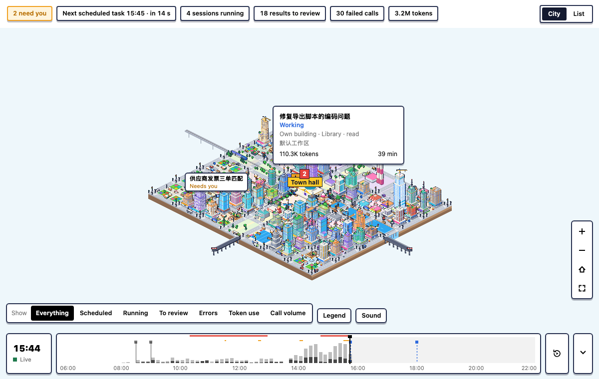
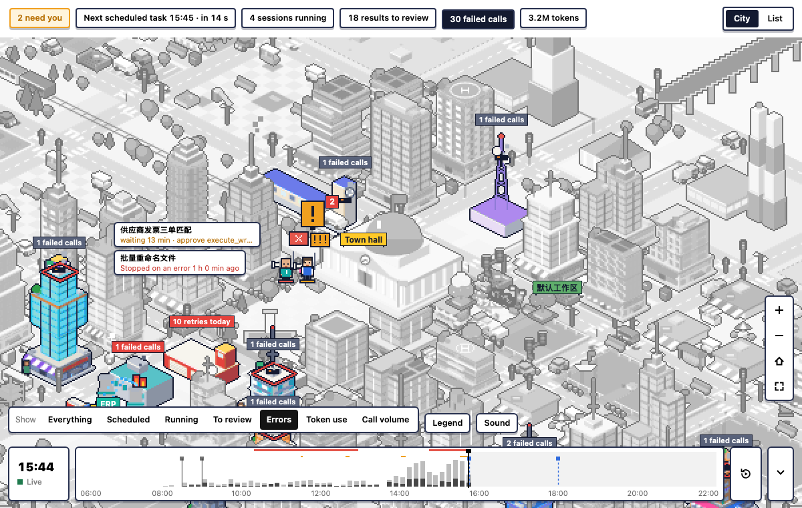
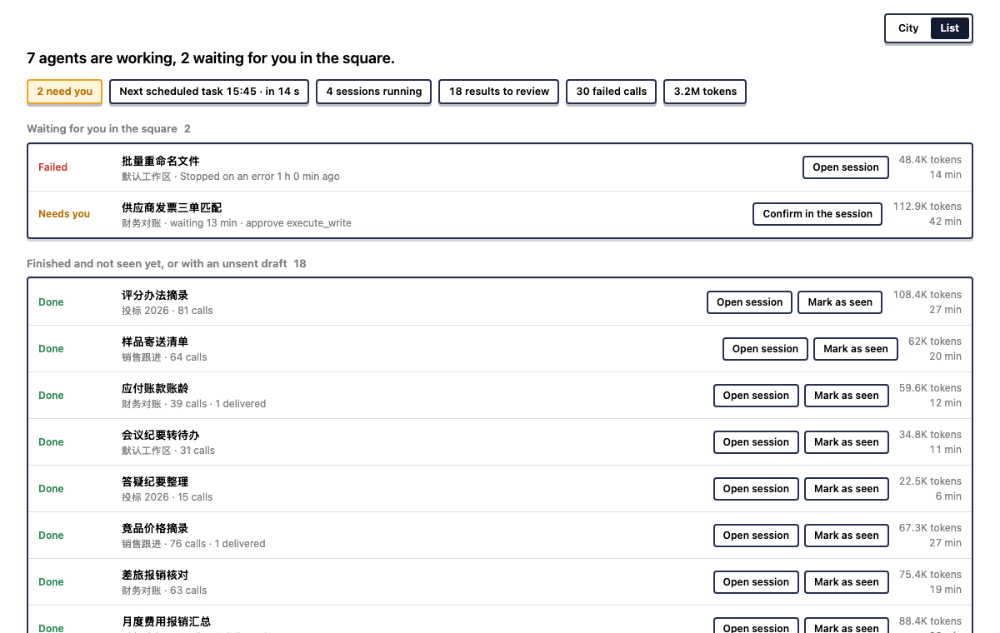
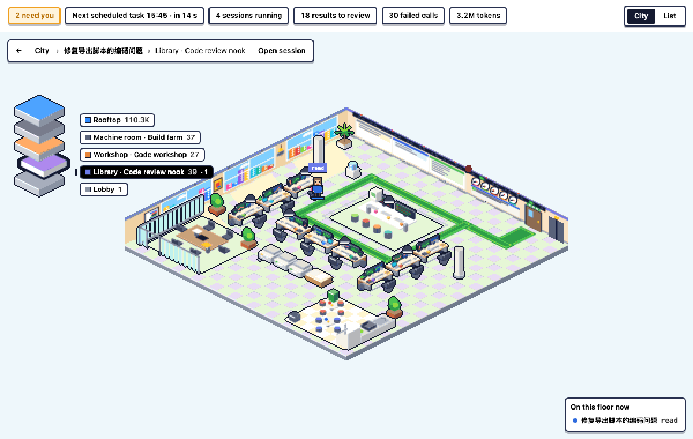

# DSH Universe 成员指南

DSH Universe 把你一天的 DSH 工作画成一座像素小城：每开一个会话就盖起一栋楼，每个代理是一个小人，每次工具调用都变成城里的车流、灯光和活动。在 DSH 侧边栏点 **DSH Universe** 打开。

## 城市里有什么

| 城市里 | DSH 里 |
| --- | --- |
| 一栋楼 | 一个会话。它做哪类工作（读文件、改文件、跑命令、连接器……），就长出哪一段，段顶有一条那类工作颜色的色带。 |
| 一个小人 | 一个代理。脚下的颜色是状态：运行中、等你确认、空闲、已完成或失败。子代理在父会话的楼里干活。 |
| 广场上举牌的人 | 这个代理在等你：审批、提问，或一份等你看的计划。 |
| 大街上的车 | 最近 5 分钟里的调用。 |
| 夜里亮着的窗 | 只有在工作或在等的地方亮灯。城里没事时一切静止。 |

广场四周是公共建筑：**市政厅**（审批和计划）、**车站**（定时任务）、**消防站**（出错）、**技能学校**（技能）、**图书馆**（你装的插件），每个模型一座**电站**。每个连接器（MCP 服务）有自己的楼，装好的插件排在插件街上。工作区是一个个街区，街区牌上写着工作区的名字。

指针移到楼上，会出现这栋楼的卡片：会话在做什么、调用次数、token 用量和用时。卡片上的 **打开会话** 直接去 DSH 里的这个会话；点一下楼就进去。打开 **图例** 可以看一页说明。第一次打开时有四步引导，之后可以在图例里点 **再看一次**。
## 广场和数据视图

市政厅前的广场是代理等你的地方。顶部「今天」一排的第一个按钮显示有几件在等你，按 `n` 跳到下一个。这一排按急缓排列：等你、定时任务、运行中、待查看、出错、token，点一下会切到对应的图层并跳到下一项。

**只看** 一栏的按钮每次只回答一个问题，其余部分变灰：

- **定时任务**：今天由定时任务启动的会话，以及下一个定时任务什么时候跑。
- **运行中**：此刻正在工作的。
- **待查看**：已经完成但你还没打开的会话。
- **出错**：失败的调用，以及因出错而停下的会话。
- **token 用量**：今天的 token 花在了哪里。
- **调用量**：哪些会话和连接器最忙。

**清单** 用文字列出同样的内容，按是否需要你处理分组。用读屏软件或在小屏幕上时，这个视图最合适。

## 时间轴和回放

底部的时间轴覆盖今天。拖动它，或按方向键（每按一次一分钟）回看任意时刻，城市会恢复成那一刻的样子。`W` 跳到下一次等待，`Shift+W` 跳到上一次。**回放今天** 把一整天从头放一遍；**回到实况** 回到实时。时间轴可以收成一条细条。

## 进楼看看

点一下楼，或在楼的卡片上点 **进楼看看**（用键盘时，`Enter` 打开画面中间的地方）。楼按层打开，每类工作有自己的房间，房间里的陈设来自这个会话的真实数字：今天的调用次数、最近一次出错、架子上有什么。代理站在他们正在干活的地方。指针移到人或家具上（或点一下）会出现小卡片。用 **楼层** 换层（电梯会把你送过去），点 **返回城市** 或按 `Esc` 离开。

公共建筑也能进去：图书馆里是你的插件，技能学校里是你的技能，车站里是今天的定时任务。

## 读什么，从不读什么

DSH Universe **只读元数据**，而且只在你自己的设备上：

- 时间、工具名、每次调用的种类、token 数，以及调用是否失败；
- 会话和工作区的标题（和 DSH 自己列表里显示的一样）、模型名、连接器名和状态、你装的插件和技能、定时任务的名字和时间。

它**从不**读取你的消息、模型的回复或思考、工具的参数和结果、文件内容、错误文字或文件路径。子代理的标题就是它的提示词，所以子代理只显示预设名，或「子代理 n」。不上传任何东西，也不会把任何内容放进提示词。当天的汇总存在本机 DSH 自己的存储里，14 天后删除。

## 一台设备一座城

每台设备各建各的城。楼盖在哪块地、哪些结果你已经看过、你的视图设置（图例、时间轴、城市或清单）都存在这台设备上，不同步。桌面和云端环境各有一座城，同一个会话在两边可能落在不同的地块上。

## 无障碍

城市里的一切在清单视图里都有。在城市里，方向键平移，`+` 和 `−` 缩放，`0` 回到广场，`Enter` 打开画面中间的地方，`Esc` 返回。系统开启「减少动态效果」后，城市每秒最多更新两次，没有闪烁。
